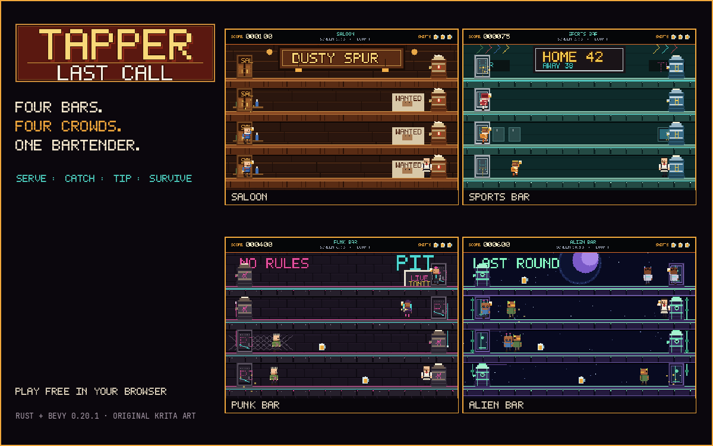
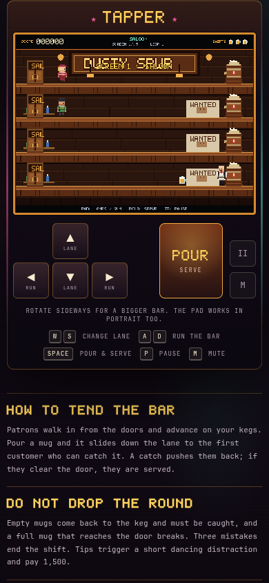
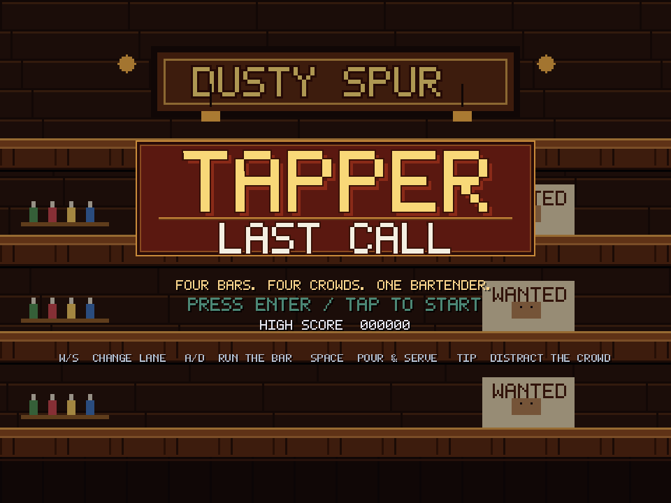
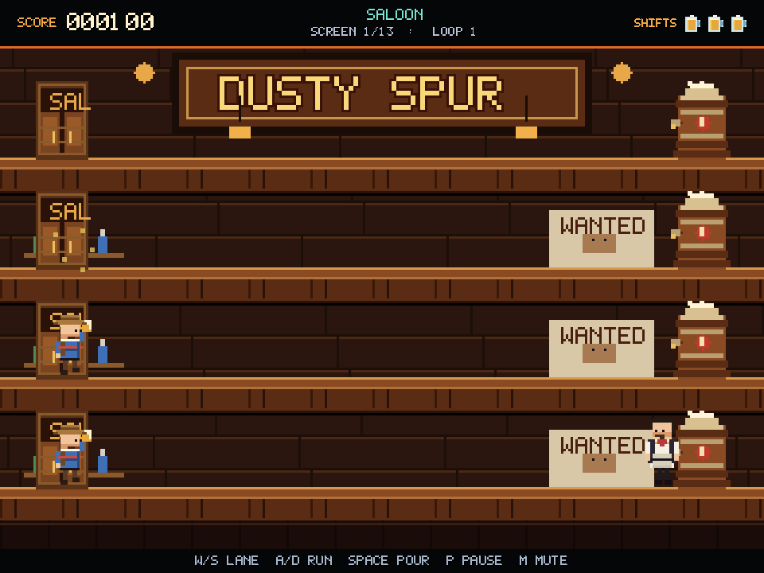
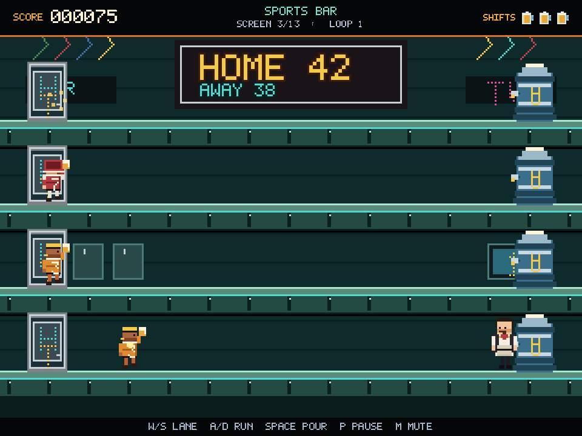
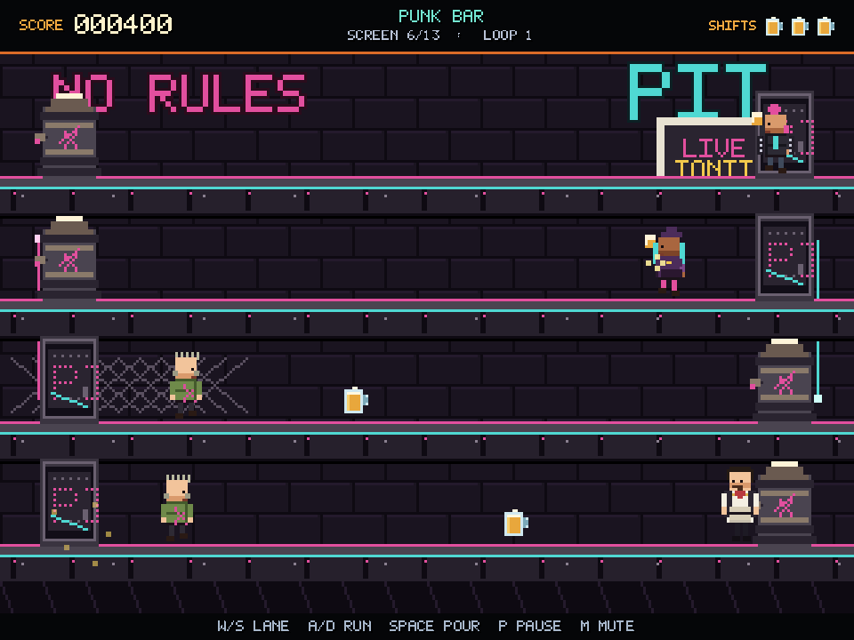
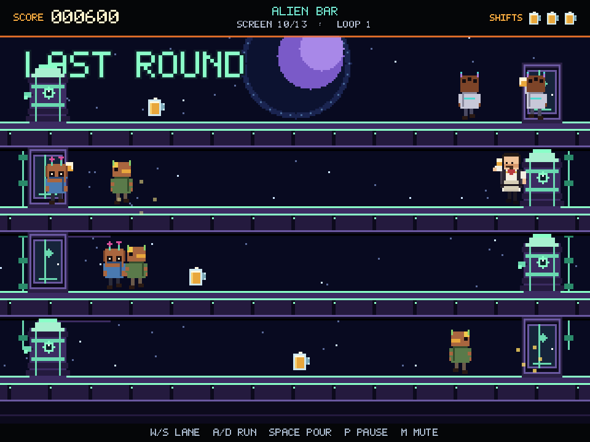
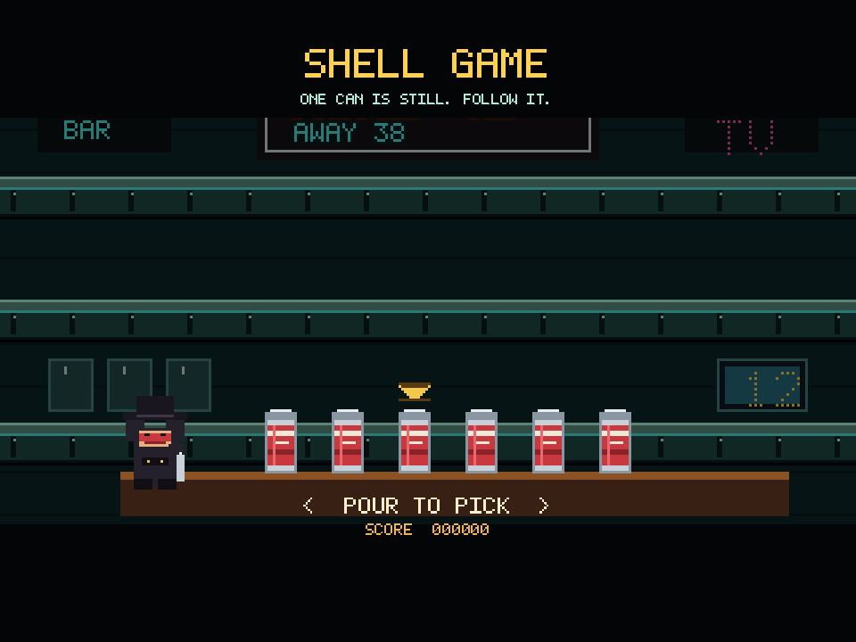

# TAPPER: LAST CALL



A complete 2D arcade bartending game in the spirit of Bally Midway's 1983
*Tapper*, written from scratch in Rust with **Bevy 0.20.1**. Four bars, four
themed crowds, sliding mugs, returning empties, tips, dancing distractions and
a shell-game bonus round — keyboard on desktop, on-screen pad on phones.

**[Play in your browser →](https://orbitmechanic.github.io/tapper-web/)**
· **[Download the Linux build →](https://github.com/orbitmechanic/tapper/releases/latest)**

Every sprite, background, animation, sound effect and music loop in this
repository was generated for this project. No art, audio or trademarks from the
arcade original are used.

## The job

You are the only bartender on shift. Patrons walk in through the doors at the
far end of each bar and advance on your kegs. Pour a mug and it slides down the
lane; the first customer who can catch it is pushed back, drinks, and sends the
empty mug back to you. Serve enough and they leave through the door. Miss an
empty at the keg, let a full mug reach the door, or let a customer reach you,
and you lose one of three shifts.

Collect **tips** left on the bar to trigger a short dancing-girls distraction:
every customer who is not already drinking or sliding back stops advancing for a
few seconds. It is the best way out of a crowded screen — and the riskiest,
because collecting a tip means running away from the keg.

## Highlights

- **Four themed bars** — the Dusty Spur saloon, the Home Team sports bar, the
  Pit punk bar, and the Last Round alien bar, each with its own wall art, kegs,
  doors, patrons, music and palette.
- **Thirteen-screen arcade progression** — the original 1/2/3/4-patron layouts,
  including mirrored lanes from the punk bar onward, then a faster loop.
- **Real Tapper rules** — patrons pushed past the door are served; empty mugs
  must be caught; full mugs break if nobody catches them; patrons who reach the
  keg grab you.
- **Tips and dancers** — +1,500 and a 4.8-second crowd distraction.
- **Shell-game bonus** — five shaken cans, one still can, a masked shaker and a
  shrinking window to follow the right one. Win 3,000; lose and wear the fizz.
- **Arcade presentation** — a 320x240 virtual playfield at 3x, a 960x720 window,
  nearest-neighbour pixels, an original 5x7 pixel TTF, and a bespoke saloon
  cabinet web shell.
- **Playable on phones** — a native HTML pointer bridge feeds the Rust game;
  the touch pad is not synthetic keyboard input.
- **Verified** — 23 headless tests (12 unit + 11 integration), clippy clean,
  captured screenshots from the running binary, and browser-tested at desktop
  and 390x844 mobile sizes.

## On a phone



The 960x720 framebuffer is scaled by CSS, the HUD stays pixel-crisp, and the
touch pad writes into the same Rust action layer as the keyboard.

## Screenshots

| | |
|---|---|
|  |  |
| **Title** — the Dusty Spur opens | **Saloon** — first round, first tips |
|  |  |
| **Sports bar** — the home team is thirsty | **Punk bar** — mirrored lanes and neon |
|  |  |
| **Alien bar** — the last round | **Shell game** — follow the still can |

## Controls

| Action | Keyboard | Touch |
| --- | --- | --- |
| Change lane (wraps at the ends) | `W` / `S` or `↑` / `↓` | ▲ / ▼ |
| Run along the bar | `A` / `D` or `←` / `→` | ◀ / ▶ |
| Pour and serve | `Space` / `J` | POUR |
| Pause | `P` / `Esc` | II |
| Mute | `M` | M |
| Start / restart | `Enter` / `Space` | TAP TO START |

The bartender snaps to the keg when you pour, exactly like the tap handle on the
original cabinet. Moving up or down also puts him back at the keg, so use lane
changes deliberately when a mug is about to break.

## Scoring

| Event | Points |
| --- | ---: |
| Serve a saloon patron | 50 |
| Serve a sports-bar patron | 75 |
| Serve a punk-bar patron | 100 |
| Serve an alien-bar patron | 150 |
| Catch an empty mug | 100 |
| Collect a tip | 1,500 |
| Clear a screen | 1,000 |
| Win the shell game | 3,000 |
| Extra shift | 20,000, then every 60,000 |

A run starts with three shifts (lives). Losing one resets the current screen's
crowd and keg position; losing the third ends the run.

## Screen structure

| Screen | Theme | Patrons per lane (top to bottom) |
| ---: | --- | --- |
| 1 | Saloon | 1 / 1 / 1 / 1 |
| 2 | Saloon | 2 / 2 / 2 / 2 |
| 3 | Sports | 2 / 3 / 3 / 3 |
| 4 | Sports | 2 / 3 / 3 / 4 |
| 5 | Sports | 3 / 3 / 3 / 4 |
| 6 | Punk | 2 / 3 / 3 / 4, top two mirrored |
| 7 | Punk | 3 / 3 / 4 / 4, bottom two mirrored |
| 8 | Punk | 3 / 4 / 4 / 4 |
| 9 | Punk | 4 / 4 / 4 / 4 |
| 10 | Alien | 4 / 4 / 4 / 4, alternating lanes |
| 11 | Alien | 4 / 4 / 4 / 4, alternating lanes |
| 12 | Alien | 4 / 4 / 4 / 4, alternating lanes |
| 13 | Alien | 4 / 4 / 4 / 4, alternating lanes |

A shell game follows screens 2, 5, 9 and 13. Screen 13 loops back to the saloon
with faster crowds, shorter push-back and tighter spawn intervals.

## Build and run

Requirements: Rust 1.97+ (developed on 1.99.1), a Linux desktop with Vulkan or
OpenGL, and the usual Bevy audio/input libraries.

```bash
git clone https://github.com/orbitmechanic/tapper
cd tapper
cargo run
```

For a distribution binary:

```bash
cargo build --release
./target/release/tapper-last-call
```

The window is a fixed 960x720 (4:3). The packaged release puts the binary next
to an `assets/` directory and the binary changes into that directory on launch,
so it runs outside the checkout:

```bash
./tools/package_linux.sh
tar tzf dist/tapper-last-call-linux-x86_64-0.1.0.tar.gz
```

The archive contains the binary, `run.sh`, README, license and runtime assets.

## Development and verification

```bash
cargo fmt --check
cargo clippy --all-targets -- -D warnings
cargo test
cargo run
```

The suite is 23 tests: level tables and difficulty curves, slot geometry,
scoring and extra lives, patron catching, door exits, empty-mug catches and
breaks, patron grabs, tips/dancers, screen-clear transitions, the bonus
shuffle and both state transitions into and out of the shell game. Tests run headless with `MinimalPlugins` and deterministic time.

Screenshots are captured from the real renderer:

```bash
BEVY_ASSET_ROOT=$PWD cargo run -- --screenshot shots/title.png --frame 150
BEVY_ASSET_ROOT=$PWD cargo run -- --start --demo --screen 6 \
  --frame 280 --screenshot shots/punk.png
BEVY_ASSET_ROOT=$PWD cargo run -- --bonus --screen 5 \
  --frame 260 --screenshot shots/bonus.png
# force a full mug off the door to exercise death -> respawn
BEVY_ASSET_ROOT=$PWD cargo run -- --start --mug-break --screen 1 \
  --frame 420 --screenshot shots/mug_break_respawn.png
```

`--demo` runs a small auto-bartender that catches empties and serves the closest
advancing patron. It is for captures and QA, not part of normal play.

## Web build

```bash
rustup target add wasm32-unknown-unknown
cargo install wasm-bindgen-cli --version 0.2.130 --locked

./tools/build_web.sh          # stages web/dist
python3 -m http.server 8123 --directory web/dist
node tools/verify_web.mjs
node tools/verify_respawn.mjs   # serve a lane, drop a mug, assert respawn
```

The build pins `wasm-bindgen` to the version in `Cargo.lock` (0.2.130), runs
`wasm-opt -Oz`, copies only runtime assets, and writes `.nojekyll`. The staged
folder is published to the separate
[`tapper-web`](https://github.com/orbitmechanic/tapper-web) repository, which
serves GitHub Pages.

The browser shell keeps the game's 960x720 framebuffer and scales the canvas
with CSS, so the pixel grid and Bevy UI are identical on a phone. Touch buttons
write held flags plus sequence counters into `window.__tapperInput`; Rust reads
that object directly every frame. Sequence counters mean even a very quick tap
is seen, regardless of frame rate. That is deliberately not a synthetic
`KeyboardEvent` bridge.

## Project layout

| Path | Purpose |
| --- | --- |
| `src/world.rs` | Geometry, 13 screen layouts, difficulty and pure rules |
| `src/game.rs` | Bartender, patrons, mugs, tips, lives, screen flow |
| `src/bonus.rs` | Shell-game state machine, scene and UI |
| `src/render.rs` | Art loading, background/keg/door spawning, sprite sync |
| `src/ui.rs` | HUD, title, pause veil, game over |
| `src/input.rs`, `src/mobile.rs` | Unified keyboard/touch actions and wasm bridge |
| `src/audio.rs` | SFX and per-theme music |
| `src/fx.rs` | Mug-break particles and camera shake |
| `src/demo.rs` | Capture/QA auto-bartender |
| `tools/krita_assets.py` | Krita-generated sprites, backgrounds, logo |
| `tools/make_audio.py` | Synthesized chiptune loops and SFX |
| `tools/make_font.py` | 5x7 pixel TTF build |
| `tools/build_web.sh` | wasm + Pages staging |
| `tools/package_linux.sh` | Linux release tarball |

## Research and credits

- [Tapper (video game), Wikipedia](https://en.wikipedia.org/wiki/Tapper_(video_game)) — mechanics, level themes, scoring, bonus game.
- [Tapper play guide, ClassicGaming.cc](https://classicgaming.cc/classics/tapper/play-guide) — screen layouts, scoring, pour technique, shell-game behaviour.
- Design, code, pixel art, font, music and SFX: Orbit Mechanic, 2026.
- Engine: [Bevy 0.20.1](https://bevy.org/). Art pipeline: [Krita](https://krita.org/).

This is an affectionate, unlicensed homage. It is not affiliated with Bally
Midway, Warner Bros. or the Tapper rights holders.

## License

MIT — see [`LICENSE`](LICENSE).
